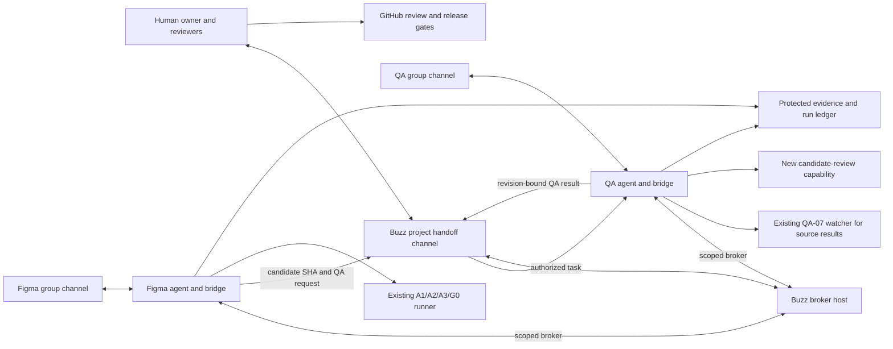

# Technical architecture: Rooh coordination on Buzz

Status: proposed contract, 2026-11-16. Applies to `Roohco/buzz` fork main `53bc826`. See [PRD](PRD.md) for product scope and [DoD](DOD.md) for release evidence.

## 1. Architectural decision

Buzz is the coordination and audit plane. Project adapters translate a small number of approved commands and completed receipts. QA-07 and Figma2Code/Strands remain the execution and domain-validation planes. Their existing source tools remain authoritative for task and release state. This follows [ADR 0002](adr/0002-coordination-not-replacement.md).

`VISION.md` and `VISION_PROJECTS.md` describe the long-term workspace and forge. This design uses only shipped relay/broker capabilities in its first slice and names the missing capabilities as later work.

The bridges may run near their harnesses and connect outbound to the broker/relay. No new general scheduler, queue or database is introduced for the first two runs. The run ledger can be a protected file or existing project store with atomic writes; make a new service only if a measured reliability requirement cannot be met locally.

## 2. Current capability boundary

| Capability | Baseline | Design use |
| --- | --- | --- |
| Signed channel messages and replies | Shipped | Pilot task and causal response |
| Channel membership and private visibility | Shipped | One explicit channel per pilot agent |
| Project record / teams | Shipped as grouping | Navigation only; no implicit repo/tool authority |
| Broker host | Status, address, channel read, message post/reply | Keyless pilot transport |
| Broker authority/effect journal | Task/generation authority and request-ID journal | Fence and reconcile a single effect |
| Job kinds 43001–43006 | Relay accepts 43001/43002/43004/43005/43006 as member-only channel events (43003 rejected); broker `job.request`/`job.admit`/`job.result`/`job.cancel` sign them for keyless agents | R5 scoped handoff: one operator grant (sender generation → recipient, channel, `qa.review_candidate`) checked by the recipient broker before any ticket |
| Workflow approval executor | Cannot persist/resume approval run | Do not use for merge, deploy or access grants |
| Broker ACP peer dispatch | Owner-only sender in broker mode (unchanged); job kinds never reach `channel.read` | Peer work enters only through `job.admit` tickets; R6 wires the QA runtime to them |
| Voice broker and relay proof | Draft PR chain, not released | Future UI over the same capability checks |

The broker signs an ordinary channel message. Its public event does not embed the broker task ID, generation or request ID. The first pilot therefore uses a reply to the initiating event as its signed causal link and stores the broker receipt in the protected ledger. It must not claim fully queryable public effect provenance or exactly-once effects.

### Channel topology for the organization MVP

Use a private Figma group channel for design/generation discussion, a private QA group channel for QA execution discussion, and a private project handoff channel containing the owner and only the agents participating in that project's pipeline. The handoff channel carries a minimal signed task/result envelope and protected artifact references, not raw design files or group-internal history. A member of either group does not automatically join the other group or gain a tool capability. For the first pipeline, provision one handoff channel explicitly; add more project channels only when a second real project needs them.

Current broker-mode ACP accepts only owner messages. A human-signed handoff can prove the recipient QA capability before peer dispatch exists, but it is not an autonomous Figma-to-QA handoff. The organization MVP requires a scoped authorized-peer extension and its negative tests. See [ADR 0006](adr/0006-cross-group-handoff.md).

## 3. Logical entities and ownership

| Entity | Authoritative owner | Minimum fields / rule |
| --- | --- | --- |
| SourceWork | Trello card, approved Figma screen, or later source tool | `source_system`, opaque `source_id`, immutable source version or design SHA, reference to original task |
| BuzzTask | Human owner, signed in Buzz | Buzz event ID, project/channel, requested bounded capability, actor, expiry and budget |
| Run | Existing harness + adapter ledger | `run_id`, source version, pinned harness revision, attempt, generation, start/end, result |
| Evidence | Protected project storage | Content hash, protected reference, type, producer, input revision; never raw secret in Buzz |
| Decision | Human in source tool or signed Buzz message as applicable | Exact input/result being approved, approver, scope and timestamp |
| EffectReceipt | Broker and external system | Broker request ID and effect state; external receipt if an effect occurred |
| Pipeline | Figma adapter ledger for one delivery item | `pipeline_id`, original source version, current candidate SHA and preview bundle digest, stage attempts, latest QA result and stop reason |
| Handoff | Signed sender and recipient in project channel | Parent event ID, recipient capability, candidate SHA, preview bundle digest, deadline/budget, acceptance/result event IDs |

`BuzzTask` is a signed message containing a preallocated `run_id` in the first real-relay experiment, not a new database entity. The ledger stores a mapping from source/run to Buzz message IDs and broker receipts. A later typed job event may replace the message template only after its publisher, consumer and authorization checks exist.

### Correlation contract

Every bridge record contains `source_system`, `source_id`, `source_version`, `run_id`, `agent_id`, `harness_revision`, `buzz_channel_id`, `buzz_task_event_id` where a task exists, `buzz_result_event_id` when acknowledged, `broker_request_id`, `generation`, `evidence_sha256` and `trace_id` where available. The idempotency key is `source_system + source_id + source_version + run_id + publication_kind`. Do not derive identity from a mutable title or URL.

Cross-group records additionally carry `pipeline_id`, `stage_id`, `parent_event_id`, exact `candidate_sha`, `preview_bundle_digest` and `recipient_capability`. QA acceptance and result events refer to the same candidate SHA and verified bundle digest. A repair record also names `parent_candidate_sha` and the QA defect result/evidence hash that prompted it. A new candidate SHA or bundle digest creates a new QA task and makes the previous QA result stale for release decisions. The protected ledger and signed event chain must agree; an unrecognized or conflicting parent stops processing.

The Buzz message presents a short human-readable summary, input revision, domain outcome, protected evidence reference and next decision. It is a projection of the ledger, not a second authority for QA verdicts or release status. The source/task ID may be opaque in public-facing text; private URLs and payloads stay in protected evidence storage.

## 4. Execution paths

### 4.1 Real-relay foundation

Provision one private channel, one human owner and one agent identity. Issue a broker credential for the exact logical agent/task/generation, configure one explicit channel and owner-only response. The owner posts a signed task mention. The agent reads it through the broker and posts one signed reply to the exact event. Quiesce admission, drain outstanding effects and fence before replacement. A successor starts only after the previous effect is terminal or explicitly reconciled.

Do not infer a successful effect from a local signer result. Verify relay acceptance, retrievability and exact signed event identity. A relay outage after signing can leave an unresolved pending effect; the broker deliberately blocks a successor until reconciliation.

### 4.2 QA evidence projection

QA-07 retains its existing polling, browser budget, receipt validation, Notion publication and Slack notification. Its current multi-card watcher records card version as reported only after Slack acknowledgement. The worker receipt by itself lacks final Notion/Slack publication state. Therefore the bridge consumes a durable watcher-completion marker that includes the exact card version, run ID and final report reference; if that marker is not currently exposed, add the smallest atomic completion receipt in the QA repository before enabling the bridge.

The bridge checks that original task text, attachments and dated reference availability are represented. If they are missing, it projects `input_incomplete` or `NOT_VERIFIED`; it does not invent a product verdict from a landing URL. It preserves product bugs, harness failures, observations and known findings as separate categories. It signs one Buzz result per idempotency key. Publication retry is independent of the QA browser run and of Notion/Slack side effects. Existing QA watcher retry behavior, including its Slack-acknowledgement edge case, remains a separately tracked source-system risk; the bridge must not amplify it.

### 4.3 Figma one-screen candidate

The owner supplies one screen-specific Figma URL and a model/time budget. The bridge pins the executable revision, invokes A1 and records exact design version, root identity and manifest SHA. A human confirms the complete frame at the A1 `SCREEN_REVIEW_REQUIRED` gate. Without that confirmation, stop.

With the same anchored input, invoke A2 source projection, A3 asset materialization and G0 isolated generation. Keep their receipts outside the evidence directories and verify each receipt hash and input identity before the next command. Treat G0 generation-only exit code 2 as a produced candidate with `generated_not_release_validated`; record build result and `browser/visual/release = not_run`. For later QA, retain a runnable static preview bundle in protected immutable storage with a canonical manifest binding the candidate git tree, G0 build receipt and SHA-256 of every served file. `preview_bundle_digest` is the SHA-256 of those canonical manifest bytes; the signed handoff carries that digest, which QA recomputes. A preview URL without this byte-level identity is insufficient. Stop on `BLOCKED`, mismatch, budget exhaustion or absent artifact. No product target write or PR follows automatically.

The existing LangGraph API decides a next action; it does not itself execute it. The bridge must call the existing commands or the existing local executor, and must not create a competing general graph. This boundary is documented in the Figma2Code handoff at upstream `develop` `8af4a66`.

### 4.4 Candidate QA capability and cross-group handoff

Before enabling peer delegation, give a human owner a way to request one QA review of a real Figma candidate. This is a new bounded QA capability, not the existing QA-07 prepayment landing watcher. It accepts an immutable candidate SHA, content-addressed preview bundle and manifest, full Figma screen/root/version, original task/reference material, G0 receipts and a time/model budget. Candidate JavaScript is untrusted: run the static preview and browser in a disposable isolation boundary with no credential mounts, no host-service reachability, a fresh browser profile with persistent workers disabled, and default-deny egress except the pinned preview origin and explicitly named local test fixtures. Keep protected design/task references in the QA process, outside the candidate page and its origin; supply them to the reviewer/model through a separate evidence path. The QA process has read-only access to candidate artifacts and cannot write them.

Before browser review, QA verifies the bundle manifest against the requested candidate git tree/SHA and G0 build receipt. It serves only those pinned bytes and verifies the HTML, script, style and asset responses actually received by the browser against the manifest. A mutable URL, stale build, unexpected outbound request or mismatched served byte blocks `PASS`; the QA result records the verified bundle identity as well as the candidate SHA. The capability returns `PASS`, `DEFECT`, `BLOCKED` or `INPUT_INCOMPLETE` with screenshots/observations and exact identities. No release verdict follows from model text alone.

After that capability passes a real review, allow the Figma agent to post a signed `qa.review_candidate` request in the shared handoff channel, addressed to the QA agent. The broker/recipient checks the sender's specific grant, channel, project, candidate SHA, budget and task generation before accepting. A typed job event may be used when its emitter/consumer/cancel path is implemented; an owner-signed message remains the fallback until then. QA posts acceptance and a signed result linked to the request. The Figma adapter may perform at most one automatic rework for `DEFECT`, using the exact prior candidate and QA evidence to produce a new SHA and new QA request. The current Figma generation contract must be audited for this repair input; if it cannot consume it safely, add one bounded repair entrypoint in that harness before enabling automation. `PASS` moves to human review; a second defect, blocked input, timeout or uncertain effect stops for the owner. No agent may promote itself to reviewer of its own candidate.

R5 operator rules for the scoped handoff (broker `job.*` actions):

- The QA recipient runs in broker mode; only its broker host admits peer requests (`job.admit`), and only tickets it returns are work inputs. A replayed `accepted` decision resumes the same run; a `completed` decision has no ticket.
- Handoff channels are private (never open) and contain only the owner and the participating agents; the relay's membership gate is what keeps other members out.
- Owner attestations for handoff agents carry no kind restriction (job kinds are not kind 9) but must carry an expiry clause, e.g. `created_at<1767225600`, and are reissued before it.
- Sender and recipient brokers share one authority state. Peer tables are additive under schema version 6, so the previous broker release still opens the state on rollback. Unpublished handoff events count as pending effects: `fence` refuses until `drain` republishes them. Rollback: `grant-revoke`, then quiesce, drain and fence the sender generation.

## 5. Identity and authorization

Each agent has its own Buzz public identity and private channel membership. The model process receives only a scoped broker credential; the signing key stays with the broker/operator. A QA mirror identity and a Figma generator identity are separate. The human owner is explicit. Project membership and persona/team labels do not grant tool permissions.

| Actor | Allowed in pilot | Denied in pilot |
| --- | --- | --- |
| QA bridge | Read completed QA receipt; post/reply in its project channel | Trigger another QA run, publish to Notion/Slack, payment mutation |
| Figma bridge | Read owner task; call A1/A2/A3/G0 for one confirmed screen; post candidate | Product repo write, PR creation, merge, deploy |
| Candidate QA agent | Review exact isolated preview and complete input; return revision-bound evidence | Modify candidate, publish QA-07 source reports, approve release |
| Figma peer after grant | Request `qa.review_candidate` for its own exact candidate in one project handoff channel | Command arbitrary QA tools, read QA group channel, grant itself further roles |
| Human owner | Request a bounded run and confirm A1 frame | Implicit approval of a different revision or later release |
| Reviewer | Inspect evidence and record decision | Elevate agent authority by joining a channel |
| Buzz workflow | Trigger only a separately verified noncritical action | Serve as durable approval gate until executor persistence is fixed |

The broker's current owner-only rule prohibits agent-to-agent command intake. Peer delegation needs a new explicit authorized-source capability, membership/role metadata and a negative test proving that an ungranted peer cannot trigger an effect. Do not merely relax `respond_to`.

## 6. States and failure handling

The shared run lifecycle is `observed → accepted → running → completed | blocked | failed | cancelled`. `completed` describes execution, not business validation. Domain outcome is separate: QA `CHECKED/NOT_VERIFIED` or Figma `generated_not_release_validated/release_validated`. Review state is separately `pending/approved/rejected`, tied to an exact result revision.

The pipeline lifecycle is `source_confirmed → candidate_ready → qa_requested → qa_running → qa_passed | qa_defect | qa_blocked → human_review`. A `qa_defect` permits one transition to `rework_candidate_ready` and then a fresh `qa_requested` for the new SHA. No previous QA pass can be reused after that transition. `human_review` is a decision point, not proof of product deployment.

| Failure | Required behavior |
| --- | --- |
| Buzz relay unavailable | Source harness continues; bridge retains unpublished receipt and retries publication only |
| Duplicate source event or bridge restart | Compare idempotency key and stored accepted event ID; do not rerun harness |
| Buzz publish accepted but acknowledgement lost | Query by known signed event ID or reconcile broker journal; do not blindly issue a new request |
| Pending broker effect after relay outage | Quiesce and drain; block successor/effects until terminal proof or operator reconciliation |
| Card/design version changes during run | Stop or mark stale; require a fresh run/confirmation for the new revision |
| Figma A1 frame incomplete or source SHA changes | Block before generation and request a human decision |
| QA evidence missing essential task context | Mark input incomplete; no product failure verdict |
| Budget/timeout reached | Stop tool execution, retain partial evidence, report blocked/failed honestly |
| Reviewer rejects candidate | Preserve history; do not mutate source task or relabel the old result |
| Handoff arrives from ungranted peer or wrong project | Reject before QA browser/model execution; retain signed denial evidence |
| QA result names a different candidate SHA | Mark conflicting/stale and stop; never attach it to the current candidate |
| QA returns a second defect | Stop automatic loop and request human direction |

The first pilot does not promise exactly-once effects. It promises no *adapter-caused* duplicate execution, durable reconciliation state and explicit operator intervention when the broker cannot prove an outcome.

## 7. Deployment, rollout and rollback

1. Create a Rooh-owned fork and pin the Buzz commit. A release is built and identified from the Rooh fork, never inferred from the personal fork or an upstream image.
2. On an isolated relay/canary, prove broker issue → signed post/reply → relay read → quiesce/drain/fence. Record exact image digest and test run. Do not reuse a synthetic empty-relay proof as production evidence.
3. Add QA bridge in observation mode, then publish one real completed run to a private channel. Compare Buzz projection with the source task, Notion report and Slack acknowledgement.
4. Add one Figma screen run after full-frame approval. Verify candidate artifacts and absence of product writes.
5. Add a human-requested candidate QA review, then a scoped peer handoff, then one real end-to-end Figma → QA pipeline with a deterministic rework fixture. Promote repeated autonomous runs only after its DoD passes.
6. Typed jobs, voice effects, durable approvals and automatic release actions each retain separate gates. The [technical roadmap](ROADMAP.md) defines the dependency order.

Rollback disables bridge publication or command intake and fences its broker generation. QA-07 and Figma2Code continue independently. Keep already published signed history; post a correction linked to the original result instead of deleting or silently rewriting it.

## 8. Verification and observability

The minimum local gate for a code-bearing slice is the affected package's unit/integration tests plus the repository-prescribed checks. The real-relay gate checks signed event acceptance and retrieval, channel denial, duplicate replay, relay-loss reconciliation and generation fencing. The QA gate uses a real card-to-Notion-to-Slack completion and one Buzz projection. The Figma gate uses one real screen and artifact review. Exact deployed revision and image digest are recorded before claiming production Done.

Use a shared `trace_id` and domain `run_id` across source, bridge, broker and harness logs. [OpenTelemetry GenAI conventions](https://github.com/open-telemetry/semantic-conventions-genai/blob/main/docs/gen-ai/gen-ai-agent-spans.md) can supply agent/tool span names; they do not require a new telemetry backend for the pilot. Record run duration, model spend, publication lag, reviewer time, rejected/invalid-input rate and pending-effect age. Never log bearer credentials or raw protected evidence.

## 9. Protocol boundaries and future triggers

- Buzz signed Nostr events: organization conversation and causal task/result record.
- [ACP](https://github.com/agentclientprotocol/agent-client-protocol/blob/main/docs/protocol/v2/overview.mdx): interactive owner-to-agent session. It is not the cross-project system of record.
- [MCP](https://github.com/modelcontextprotocol/modelcontextprotocol/blob/main/docs/specification/2026-07-28/basic/authorization/index.mdx): tool boundary; authenticate the caller, bind token audience and restrict effects.
- Existing Figma2Code/Strands graph: deterministic steps inside that project. [Strands multi-agent patterns](https://strandsagents.com/docs/user-guide/sdk/multi-agent/multi-agent-patterns/) remain local to a harness.
- [A2A](https://a2a-protocol.org/dev/specification/agent-card/): consider when an external, independently operated agent is an actual integration consumer. Do not introduce it for two internal bridges.

Move to typed Buzz jobs only when there is a tested emitter, consumer, cancellation, peer/source authorization, durable state and UI benefit. Move to voice effects only when the same capability grant and exact task confirmation are enforced for speech-derived requests.

## 10. Source evidence for this baseline

- Buzz: [job kinds](../../crates/buzz-core/src/kind.rs), [broker-mode ACP gate](../../crates/buzz-acp/src/config.rs), [broker host contract](../../crates/buzz-broker-host/README.md), [broker message arguments](../../crates/buzz-sdk/src/broker/actions/args.rs), [workflow approval executor](../../crates/buzz-workflow/src/executor.rs).
- QA: [watcher completion and publication sequence at b126047](https://github.com/Roohco/qa-agent/blob/b126047f74b68b1e42b32ca435997ed8f7018071/scripts/qa07-cookie-watch.mjs#L258-L402). Access to this Rooh repository may be restricted.
- Figma: [runtime action contract at 8af4a66](https://github.com/Roohco/figma2code-agent/blob/8af4a66/src/figma2codeRuntimeContracts.mts#L27-L136) and [G0 generation-only outcome](https://github.com/Roohco/figma2code-agent/blob/8af4a66/src/runG0GeneratedVisual.mts#L1494-L1515). Access to this Rooh repository may be restricted.
