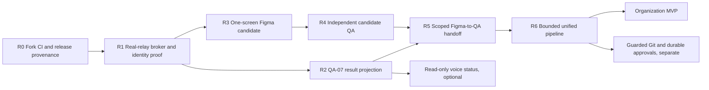

# Technical roadmap: Rooh agents on Buzz

Status: proposed execution sequence, 2026-11-16. Scope: the Rooh-owned `Roohco/buzz` fork plus explicitly named changes in the QA Agent and Figma2Code/Strands repositories. This is a milestone roadmap; each code-bearing milestone still receives a small implementation plan before edits. [PRD](PRD.md) defines user outcomes, [architecture](ARCHITECTURE.md) defines boundaries, and [DoD](DOD.md) defines release evidence.

## 1. Destination and two honest finish lines

**Initial pilot:** Buzz can show one existing QA-07 result and one pinned Figma candidate with signed identity, evidence and human review. It proves coordination, not autonomous cooperation.

**Organization MVP:** the Figma agent hands a candidate to a distinct QA agent through a private project handoff channel; QA checks the actual preview against complete input; a defect can trigger one bounded Figma rework and fresh QA; a human retains release authority. This is the first genuine multi-group pipeline. The existing QA-07 prepayment landing watcher is not the candidate reviewer.

The current fork main is `53bc826`. The QA and Figma evidence baselines are `b126047` and `8af4a66` respectively. These are planning pins, not a promise that future runners or deployed images use them. On 2026-11-16 the new Rooh fork initially reported Actions enabled but zero registered workflows and runs. Reapplying the repository Actions permissions through GitHub's API caused 19 workflows to register. This is an observed remediation; the original GitHub state remains uncertain. A branch push alone does not prove CI activation because the current CI workflow triggers on main/release push or PR. Witnessing a real PR check remains R0.

## 2. Dependency order

R2 and R3 may be developed in parallel after R1 because they live in different harnesses. Activate and evaluate them one at a time: QA projection first, then Figma generation. R4 can prototype once R3's candidate/preview contract is fixed. R5 may be designed alongside R4 but cannot be enabled until a real candidate QA review passes. This preserves speed without introducing two unverified trust boundaries in one rollout.

| Milestone | Main owner/repository | Provisional size | Dependency | User-visible result |
| --- | --- | --- | --- | --- |
| R0 | `Roohco/buzz` CI/release | S, 1–2 days | Fork exists | Rooh PR checks and artifact provenance can be witnessed |
| R1 | `Roohco/buzz` broker, ACP, relay tests | M, 3–5 days | R0 | One owner and one keyless agent exchange a signed task/reply |
| R2 | QA Agent watcher and QA bridge | M, 3–5 days | R1 | Completed QA-07 run appears once for review in Buzz |
| R3 | Figma2Code bridge and existing A1/A2/A3/G0 | M, 4–7 days | R1 | One pinned, explicitly unvalidated candidate appears in Buzz |
| R4 | QA Agent candidate-review capability | M, 4–7 days | R3 | Distinct QA agent checks actual candidate preview |
| R5 | `Roohco/buzz` scoped peer grant and job path | L, 7–12 days | R2, R4 | Figma agent can request only candidate QA across groups |
| R6 | Figma/QA adapters and one project handoff channel | L, 5–10 days | R5 | One bounded Figma → QA → optional repair → human pipeline |

Ranges are engineering estimates under working CI, access and preview contracts; they are not calendar dates. Re-estimate at R1 and again after R4. Do not expand a milestone to absorb unrelated upstream security, voice or UI work.

## 3. R0 — establish a trustworthy Rooh delivery path

**Work.** Record the upstream/parent commit map and keep integration changes in `Roohco/buzz`. Determine why the new fork's Actions API lists no workflows despite the workflow files and enabled repository setting. Trigger a disposable review PR against the fork, observe workflow registration, then confirm a code-bearing change schedules its affected checks. Keep existing changed-path routing; use narrow required checks for affected code and a broad release/nightly gate. Do not create an empty push loop or remove a security gate merely to make CI green. Establish a Rooh-built relay/broker image path with source commit and digest recorded. Review open personal-fork security/voice PRs individually; they are not implicitly part of Rooh main.

**Gate R0.** A real Rooh PR displays a terminal required check result, and a broker-code PR routes to broker checks rather than a permanently pending or skipped required context. A Rooh canary artifact maps to an exact fork commit and digest. The cause of the previous zero-workflow observation is recorded. The repository-prescribed local gate is run before the first code PR, with any environment failure reported separately. No production claim follows from this gate.

**Stop/rollback.** If CI cannot register or required checks cannot complete, do not promote a Rooh image. Keep the current production relay untouched while diagnosing the workflow/ruleset state.

## 4. R1 — prove one agent can act and be fenced on a real relay

**Work.** Provision one private channel, one human owner and one broker-backed agent identity on an isolated Rooh canary. Use existing broker issue, channel read, message reply, effect journal, quiesce, drain and fence contracts. Add only the minimal Rooh wiring or focused tests revealed by the real-relay run. The signed task contains a preallocated run ID; the signed result replies to that exact event. Persist the broker request ID and generation in protected operator evidence.

**Gate R1.** Owner task and agent reply are accepted and retrievable with exact event IDs; a non-member is denied; duplicate request and lost acknowledgement reconcile without a second agent turn; the old generation cannot start a new effect after quiesce/fence. Demonstrate one relay-outage pending-effect path and operator reconciliation. Attach exact canary revision/digest and local plus relay-backed test output. Synthetic empty-relay proof alone fails the gate.

**Stop/rollback.** If a pending effect cannot be resolved, keep successor admission closed. Fencing the broker generation leaves source harnesses independent.

## 5. R2 — project existing QA evidence without rerunning QA

**Work.** In QA Agent, add the smallest atomic watcher-completion marker containing card ID/version, run ID, report reference, actual Notion/Slack outcomes and finding categories. The current browser worker receipt alone is too early for publication state. A QA-owned bridge maps that marker to one signed Buzz result and a protected run ledger. Preserve task text, attachments and dated reference availability; publish `input_incomplete` or `NOT_VERIFIED` if essential input is absent. The bridge never starts the browser or publishes to Notion/Slack.

**Gate R2.** One real eligible card completes on the intended QA revision and its Buzz projection matches the source task/report. Replay, restart and relay-outage tests create no adapter-caused duplicate run or external publication; a missing-reference fixture yields no unsupported `FAILED`. Run `npm test` in QA Agent and the focused real card-to-Notion-to-Slack-to-Buzz check. Record exact watcher/bridge revisions, Buzz event and report hash. Existing QA watcher Slack-acknowledgement duplicate risk is measured and tracked separately.

**Stop/rollback.** Disable only bridge publication; QA-07 continues. If no durable completion marker or full source context exists, fix that input boundary before adding model prompts or Buzz verdict logic.

## 6. R3 — expose one Figma candidate with honest status

**Work.** In Figma2Code/Strands, add a narrow bridge around existing A1 → A2 → A3 → G0 commands. Pin the executable revision and one screen/root/version. Require human confirmation of A1's complete frame. Verify the A1/A2/A3 receipts and hashes before G0. Keep the candidate tree and runnable static build artifacts in protected immutable storage. Produce a manifest that binds the candidate git tree, G0 build receipt and SHA-256 of every file the preview may serve, so later QA can verify actual bytes without product-repository writes. Publish the candidate SHA/git tree, build status and `generated_not_release_validated` outcome to Buzz.

**Gate R3.** One real screen reaches a candidate with pinned Figma and source identities; G0 generation-only exit 2 is treated as produced but `browser/visual/release = not_run`. The protected static bundle and file-hash manifest can be retrieved for the exact candidate tree and build receipt; a URL alone does not advance to R4. Wrong frame, changed SHA, `BLOCKED` and budget exhaustion stop cleanly. Run `npm run typecheck`, `npm test` and the single-screen live gate on the pinned runner. Verify product repo and PR state did not change. Record model cost, artifact hash and owner review.

**Stop/rollback.** Disable the bridge or candidate publication; existing Figma harness remains usable. A candidate without pinned runnable artifacts does not advance to R4.

## 7. R4 — make the QA group able to review a candidate

**Work.** Add `qa.review_candidate` as a separate bounded QA Agent mode. Reuse its isolated browser/model boundary where suitable, but do not route through QA-07's prepayment landing classifier or Trello watcher. Treat the generated preview as untrusted executable content: run it and the browser in a disposable boundary without credential mounts or host-service access; deny egress except the pinned static preview origin and explicit local fixtures; use a fresh profile with persistent workers blocked. Give the candidate page no protected design/task references; pass them to QA through a separate evidence path. Input is an exact candidate SHA, the R3 bundle and file-hash manifest, full Figma screen/root/version, original task/reference, G0 receipts and budget. QA verifies source/build binding and browser-served file hashes before a verdict. Output is `PASS`, `DEFECT`, `BLOCKED` or `INPUT_INCOMPLETE` with browser evidence, verified bundle identity and the same candidate SHA. At this stage the owner signs the request; no peer grant is needed.

**Gate R4.** A distinct QA identity checks a real candidate preview and a human reviewer can reproduce the verdict from the supplied input/evidence. Missing preview, incomplete frame/reference, changed SHA, stale or mutated served bytes, and unexpected network requests cannot produce `PASS`. Negative tests show candidate JavaScript cannot reach QA credentials, protected references, host services or arbitrary external origins. The QA runner has no candidate write or release capability. Run QA `npm test` plus the focused browser integration and a real preview review. Record exact QA revision, manifest/served-byte hashes, input hashes and cost.

**Stop/rollback.** Disable this QA mode. If its input is incomplete, stop; do not reuse a QA-07 verdict or a Figma self-review as independent QA.

## 8. R5 — allow one scoped autonomous handoff between groups

**Work.** In the Rooh Buzz fork, expose a complete minimal task path using the existing request (43001), accepted (43002), result (43004), cancel (43005) and error (43006) kinds. Progress (43003) can wait until a user needs it. Add one broker grant for Figma identity → QA identity, project handoff channel and `qa.review_candidate` only. The Figma and QA internal channels stay private. Carry `pipeline_id`, parent event, candidate SHA, preview bundle digest, recipient capability, budget, deadline, attempt and idempotency key. Recipient acceptance, result and cancellation are signed and linked to the same candidate and bundle identities. Keep the operator-facing status readable without building a generic organization role hierarchy.

**Gate R5.** On a real relay, an authorized Figma request is accepted and produces one QA run/result for the same SHA and verified preview bundle digest. Ungranted peer, wrong project/channel, stale SHA or bundle digest, expired budget and fenced generation are denied before browser/model work. Duplicate, cancel, restart and acknowledgement-loss cases have terminal or explicitly unresolved states. Run the repository `just ci` gate before PR, focused broker/ACP/relay integration tests and the two-identity live proof. A human forwarding a task does not count as R5.

**Stop/rollback.** Revoke the peer grant and fence its generation; owner-requested R4 remains usable. Do not relax broker `owner-only` globally to pass the test.

## 9. R6 — close the Figma → QA → rework loop

**Work.** The Figma adapter posts a candidate and scoped QA request in one private project handoff channel. QA accepts, checks the pinned bundle and preview, then posts a result bound to the candidate SHA and verified bundle digest. `PASS` moves to human review. For `DEFECT`, first verify whether the pinned Figma harness can accept prior candidate plus QA evidence as repair input; if it cannot, add one bounded repair entrypoint there. One repaired candidate cites the parent SHA and defect evidence, then receives a fresh QA request. The previous QA verdict is stale when either candidate or served bundle identity changes. Second defect, `BLOCKED`, `INPUT_INCOMPLETE`, timeout, cancellation or unresolved broker effect stops for the owner. The shared pipeline ID links all stages, while group-internal discussion remains private.

**Gate R6.** One real screen completes the autonomous Figma → QA → human-decision path. A deterministic defect fixture proves one repair from the exact prior SHA/QA evidence and a fresh QA run for the new bundle; another defect proves stop. Reviewers can traverse the signed task/result chain, candidate/bundle identities and protected evidence hashes. Negative tests prove that neither agent can approve its own release, read the other group's internal channel or cause product/payment/deploy effects. Measure end-to-end latency, model cost, handoff time, QA quality and blocked rate. Verify exact deployed Rooh revision/digest and rehearse disabling auto-dispatch without stopping the project harnesses.

**Stop/rollback.** Disable automatic peer requests and revert to owner-requested R4 review. Preserve signed history and source artifacts. The initial pilot may remain live; the organization MVP is not Done until this gate passes.

## 10. CI, review and release policy across milestones

| Change class | Fast local evidence | Required remote evidence | Real-user proof |
| --- | --- | --- | --- |
| Buzz broker/relay/protocol | Repository-prescribed `just ci` before PR; focused crate and relay integration tests | Affected path-scoped PR checks terminal and green; release artifact from Rooh commit | Real relay, two identities, denial and fence/recovery |
| QA watcher/bridge | `npm test` and focused receipt/replay tests | QA repository checks for exact revision | Real card and actual publication outcomes |
| Figma bridge | `npm run typecheck`, `npm test`, receipt/identity tests | Figma repository checks for pinned revision | One approved screen and inspectable candidate |
| Candidate QA | `npm test` and focused browser capability tests | QA repository checks for exact revision | Real isolated preview and reviewer confirmation |
| Cross-group pipeline | Relevant checks in all changed repositories | One reviewed completed slice per repo; no broad CI push loop | Real handoff plus deterministic defect/rework proof |

Keep changed-path CI routing and one broad release/nightly safety net. A required status must never remain pending because a path-skipped job did not report. A full platform suite is not a substitute for the real workflow; a local green test is not a substitute for an exact deployed revision. Gather review/CI findings before one batched correction push, per Rooh delivery policy.

## 11. After the organization MVP

- **Voice:** a read-only status/draft experience can be evaluated after R2 without changing agent authority. Effectful voice commands wait for R5/R6 grants and exact human confirmation. The personal fork's open voice PR chain is reviewed and ported deliberately, not assumed deployed.
- **Durable approvals and Git effects:** only after Buzz workflow approval persistence/resume and repository-specific write contracts pass separate tests. Existing GitHub/release gates remain authoritative meanwhile.
- **Additional groups and projects:** add a second handoff channel only when the first channel's contract works for a second real use case. Generalize grants after repeated evidence; do not prebuild a global swarm.
- **External A2A:** introduce only for a named independently operated agent service with an actual interoperability need.

## 12. Decision rule at every gate

Advance only with the listed evidence. If the first failure is missing source input, fix input; if it is a wrong verdict, fix domain validation; if it is an unproven effect, reconcile the broker; if it is a CI registration issue, fix CI before remote promotion. A model-generated summary, synthetic container run, draft PR or green local unit suite never silently upgrades the status of a later gate.
